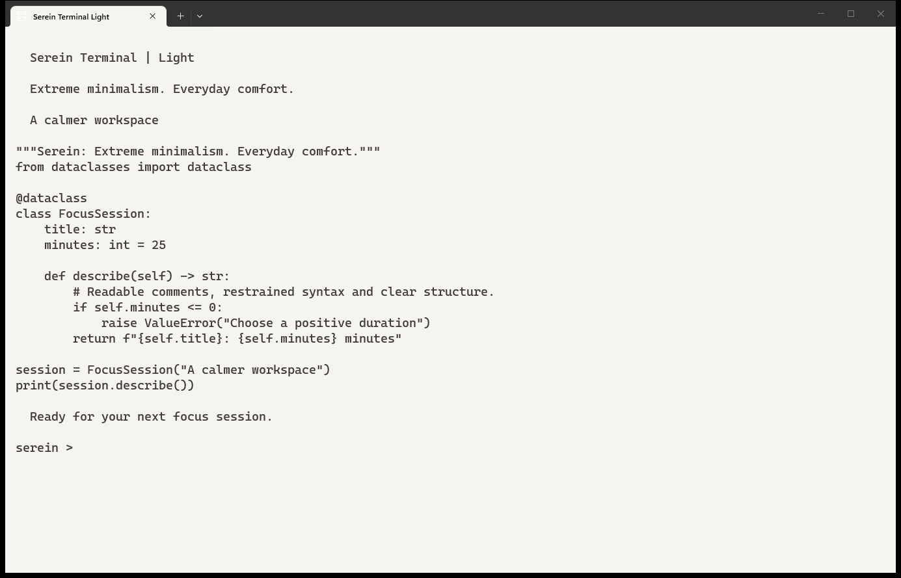
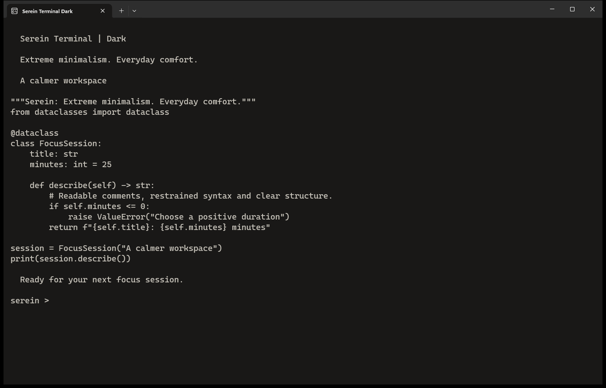

# Serein for Windows Terminal — Minimalist Warm Color Scheme

[](https://github.com/cmduyeen/serein-terminal/releases/latest)
[](LICENSE)
[](https://github.com/cmduyeen/serein-theme)
[](https://cmduyeen.github.io/)

**Extreme minimalism. Everyday comfort.**

Serein for Windows Terminal brings quiet, low-glare color palettes to your command-line interface. Designed for PowerShell, Command Prompt, Git Bash, and WSL (Ubuntu/Debian/Arch), it eliminates eye-fatiguing pure black backgrounds and blinding neon text.

- **Serein Alabaster (Light):** Soft ivory terminal canvas with dark charcoal text for high-glare daytime environments.
- **Serein Obsidian (Dark):** Warm charcoal background with gentle creamy foreground for late-night terminal productivity.

[Download Latest Release](https://github.com/cmduyeen/serein-terminal/releases/latest) · [Full Serein Suite](https://github.com/cmduyeen/serein-theme) · [Read Terminal Customization Guide](https://cmduyeen.github.io/)

---

## Preview

| Serein Alabaster · Light Mode | Serein Obsidian · Dark Mode |
|---|---|
| [](https://github.com/cmduyeen/serein-terminal/releases/latest) | [](https://github.com/cmduyeen/serein-terminal/releases/latest) |

---

## Key Highlights

- **ANSI 16-Color Harmony:** Both normal and bright colors are calibrated to prevent unreadable text when running CLI tools (`ls`, `git status`, `npm`, `htop`, `docker`).
- **Warm Canvas:** Avoids the harsh glare of `#000000` and `#FFFFFF`, keeping contrast comfortable for long command-line sessions.
- **Automated PowerShell Script:** Quick one-liner install and restore script included.

---

## Installation

### Method 1: Automated Script (PowerShell 7)
1. Download and extract the latest `serein-terminal-*.zip` from the [Releases page](https://github.com/cmduyeen/serein-terminal/releases/latest).
2. Open PowerShell in the extracted folder and run:
   ```powershell
   # Install and apply Alabaster (Light) as default:
   ./install.ps1 -Mode Light -SetDefault -Launch

   # Or install and apply Obsidian (Dark) as default:
   ./install.ps1 -Mode Dark -SetDefault -Launch
   ```
3. To revert back to your previous settings at any time, run:
   ```powershell
   ./restore.ps1
   ```

### Method 2: Manual JSON Configuration
Add the Serein color scheme objects into your Windows Terminal `settings.json` under `"schemes"`:
See the included configuration JSON or read the step-by-step tutorial on [Dyn's Blog](https://cmduyeen.github.io/).

---

## Complete the Serein Workspace

Pair your command-line with matching editors and system apps:

- 💻 **[Serein for VS Code](https://github.com/cmduyeen/serein-vscode)** — Code editor theme for web and software developers.
- 💻 **[Serein for Neovim](https://github.com/cmduyeen/serein-neovim)** — Native Lua terminal colorscheme.
- 📓 **[Serein for Obsidian](https://github.com/cmduyeen/serein-obsidian)** — Distraction-free markdown knowledge base.
- 🪟 **[Serein for Windows](https://github.com/cmduyeen/serein-windows)** — System theme and 4K wallpapers.
- 🌐 **[All 10+ Serein Ports](https://github.com/cmduyeen/serein-theme)** — The central hub and design specifications.

---

## Honest Design & Limitations

Themes are aesthetic preferences and visual comfort tools, not medical treatments. Serein has not been clinically tested to treat eye fatigue. Proper workspace lighting and regular screen breaks remain essential.
- [American Academy of Ophthalmology: Computer Usage Guidance](https://www.aao.org/eye-health/diseases/computer-usage)
- [Full design reference & limitations](https://github.com/cmduyeen/serein-theme/blob/main/REFERENCE.md)

---

## Author & License

Created and maintained by **[Dyn (cmduyeen)](https://cmduyeen.github.io/)**.
- Personal Blog: [cmduyeen.github.io](https://cmduyeen.github.io/)
- GitHub: [@cmduyeen](https://github.com/cmduyeen)

Released under the [MIT License](LICENSE).
